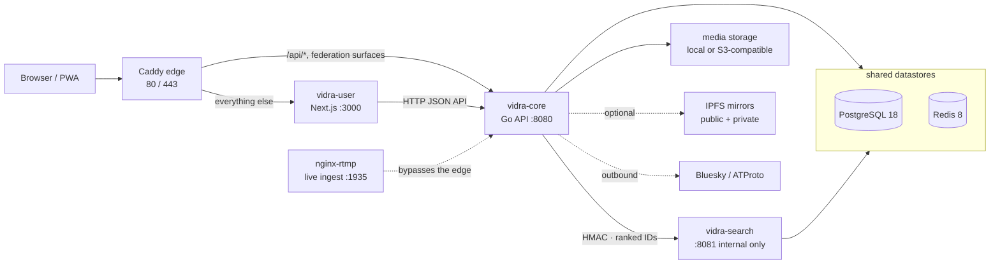

# Architecture

Vidra is three independent services behind a single origin. Understanding two
things explains most of the rest: **only Caddy faces the internet**, and
**everything the browser touches is one origin**, split by path.

## Three repos, one meta-repo

| Repo | What | Stack |
|---|---|---|
| [`vidra-core`](https://github.com/yegamble/vidra-core) | Backend and HTTP API | Go, Echo, PostgreSQL, sqlc, Redis |
| [`vidra-user`](https://github.com/yegamble/vidra-user) | Frontend | Next.js, TypeScript, Tailwind |
| [`vidra-search`](https://github.com/yegamble/vidra-search) | Search, autosuggest and recommendations | Go, PostgreSQL, Redis |

They are tied together by the lightweight [`vidra`](https://github.com/yegamble/vidra)
meta-repo, whose `docker-compose.yml` `include:`s vidra-core's compose file and
adds the frontend, search and search-migrate services. Each component repo is
self-contained — its own `go.mod` or `package.json`, its own Docker setup, its
own GitHub Actions CI.

The frontend consumes the backend's HTTP API at **runtime** via
`NEXT_PUBLIC_API_BASE_URL`, with no build-time coupling, so one image serves any
domain. `vidra-search` is **internal only**: HMAC-authenticated, called only by
`vidra-core`, never exposed to the browser.

## The edge

Caddy is the only internet-facing service, on 80 and 443. It path-routes a
single origin:

- `/api/*`, `/healthz`, `/readyz`, `/version`, `/sitemap.xml`, `/feeds/*`,
  `/nodeinfo/*` and `/.well-known/*` → the api on `127.0.0.1:8080`
- everything else → the frontend on `127.0.0.1:3000`

Postgres, Redis and search publish nothing at all; api and frontend publish on
loopback only. That is what the `!reset` / `!override` merge tags in
`docker-compose.prod.yml` do, and why Compose 2.24 is a hard floor.

Two deliberate edge rules are worth knowing before you put a CDN in front:
`/metrics` is answered **404 unconditionally** (the route is root-mounted with
no auth, so it must be scraped from inside the compose network), and `encode` is
applied only to the frontend site block — edge compression on already-compressed
media buys nothing and breaks Range requests, which is how seeking works.

**One exception to the edge:** live RTMP publishes `0.0.0.0:1935` around it,
because OBS on a creator's laptop dials it directly and a reverse proxy cannot
stand in front of an RTMP ingest.

Setting `VIDRA_TLS_MODE=external` withholds the `edge` compose profile
entirely — the Caddy service is not in the project at all — and hands routing,
`X-Forwarded-Proto`, body-size limits and `TRUSTED_PROXY_CIDRS` to your own
proxy. `vidra setup` writes `deploy/nginx-external.conf.example` mirroring the
Caddyfile's split exactly; start from it, because a hand-written proxy that
sends `/feeds/*` to the frontend 404s every feed link and nothing errors.

## Configuration: two layers

**Env-only `config.Load`** is a fail-fast monolith with a `validate()` that
hard-refuses unsafe values in production. Secrets and boot-unsafe values live
here and only here.

**`internal/instancesettings`** is a typed, validated, runtime-mutable
DB-overlay registry with page and section metadata that **auto-renders the admin
configuration UI**. Runtime knobs reach workers through provider-func closures,
read at request or job time, never baked in at boot — which is what makes a
setting change take effect without a restart.

The split is a doctrine, not an accident: if a value cannot be changed safely
while the process is running, it is env-only. See
[Configuration](../reference/configuration.md).

## Workers and queues

Background work — transcoding, imports, caption jobs, IPFS pinning, sweeps —
runs on **durable Postgres queues** with backoff and dead-lettering. Every queue
claims work with `FOR UPDATE SKIP LOCKED` plus a lease visibility timeout and
state-guarded terminal writes, so a second process can never take the same job,
and a process that dies mid-job releases it rather than losing it. Sweep-only
crons are leader-elected.

`VIDRA_ROLE` (`all` | `api` | `worker`) decides what a container runs. The
default single-container topology (`all`) is the supported one. Setting
`EXTRA_COMPOSE_PROFILES=worker` and `API_ROLE=api` moves every background
worker — ffmpeg included — into separate `worker` containers running the same
image, so the api's CPU and memory budget can shrink to a web-serving envelope.

:::warning No interlock
`API_ROLE=api` with no worker container running means **nothing transcodes,
imports or sweeps at all**, and nothing warns you. Split the roles deliberately
or not at all.
:::

## The API contract

`vidra-core/api/openapi.yaml` is the source of truth for the HTTP API — 228
paths today. `vidra-user` regenerates its client from it; never hand-edit the
generated shapes. A `contract-ci` job guards drift twice: one check asserts
every `/api/` path the frontend calls exists in the spec, and a codegen step
fails if the generated client is stale.

`vidra-search` exposes a separate, internal contract at
`vidra-search/api/openapi.yaml`, all under `/internal/v1`, HMAC-authenticated,
consumed only by `vidra-core`.

A breaking change spans two repos with no atomic commit, so it is staged
back-compat: land the additive change in `vidra-core`, update `vidra-user`,
remove the old endpoint in a later `vidra-core` change.

## Next

- [The video pipeline](./video-pipeline.md) — upload to playback.
- [Federation](./federation.md) — ActivityPub and ATProto.
- [Storage and media](./storage-and-media.md) — local, S3, IPFS.
