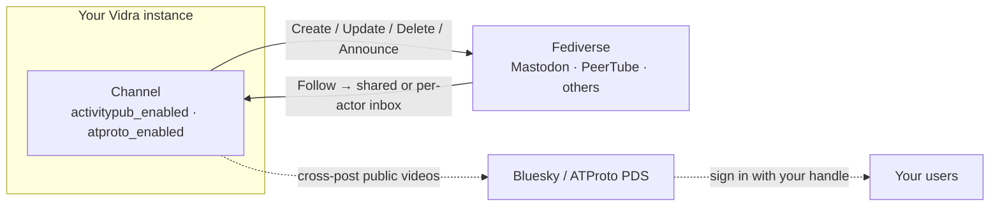

# Federation

Vidra federates over **two protocols that do different jobs**, and they are
independently switchable. An instance may run ActivityPub only, ATProto only,
both, or neither.

| | ActivityPub | ATProto |
|---|---|---|
| What it is for | Federating **channels and their videos** to the fediverse | **Identity** (sign in with a Bluesky or any-PDS handle) and **cross-posting** public videos to Bluesky |
| Direction | Inbound and outbound | Identity is inbound; cross-posting is outbound only |
| Master switch | `FEDERATION_ENABLED` | `ATPROTO_LOGIN_ENABLED` for identity, `ATPROTO_ENABLED` for cross-posting |
| Default | Off | Off |
| Per-channel control | `activitypub_enabled` | `atproto_enabled` |

Both default to **off**, and while a switch is off its routes are not mounted at
all — they answer 404 or 503 rather than existing and refusing. Turning
federation on is a decision, not an accident.



## ActivityPub

With `FEDERATION_ENABLED=true` and a configured `PUBLIC_BASE_URL`, the api
mounts the fediverse surfaces at the **root**, outside `/api/v1` — they are a
federation contract, not part of the REST API:

| Route | What |
|---|---|
| `/.well-known/webfinger` | Resolves `acct:name@domain` to an actor |
| `/.well-known/nodeinfo`, `/nodeinfo/2.1` | Instance discovery |
| `/accounts/{handle}`, `/video-channels/{handle}` | Actor documents (Person and Group) |
| `/inbox`, `/accounts/{handle}/inbox`, `/video-channels/{handle}/inbox` | Inbound activities — a shared inbox plus the per-actor inboxes the actor documents advertise, all through one signature-verifying handler |
| `/accounts/{handle}/followers` · `/following` · `/outbox` | Read-only actor collections |
| `/video-channels/{handle}/followers` · `/following` · `/outbox` | The same; the channel outbox is paged (`?page=N`) |

Users and channels are both federated actors — a Person and a Group — and each
needs a keypair. Those private keys are envelope-encrypted at rest under
`FEDERATION_KEY_KEK`.

:::danger `FEDERATION_KEY_KEK` is not rotatable
There is no re-wrap job. Nothing in the codebase re-encrypts persisted rows
under a new key-encryption key, so rotating it makes every stored federation
actor key unreadable. Worse, `ATProtoKEK()` and `MFAKEK()` **fall back to
`FederationKeyKEK`** when their own value is unset, so rotating it on an
instance that never set `ATPROTO_KEY_KEK` or `MFA_KEY_KEK` silently destroys
linked Bluesky app passwords and every TOTP secret too. Set all three
separately, and treat a rotation as a user-visible re-enrolment event.
:::

### Per-channel opt-out

A creator opts a channel out of either protocol from the studio's Channel tab
(owner only). Both flags default to true, so existing channels keep federating
exactly as before. The enforcement is concrete:

- `activitypub_enabled=false` — inbound `Follow` is ignored, and outbound
  `Create` / `Update` / `Delete` / `Announce` are skipped for that channel.
- `atproto_enabled=false` — the channel's published videos are never enqueued
  for a Bluesky cross-post.

## ATProto

Two independent features, two switches.

**Identity login** (`ATPROTO_LOGIN_ENABLED`) lets a user sign in with a Bluesky
handle or any ATProto PDS, through
`/api/v1/auth/atproto/start` and `/api/v1/auth/atproto/callback`, with client
metadata served at `/api/v1/auth/atproto/client-metadata.json`. It keeps **no
PDS tokens**, so it needs no key-encryption key.

**Cross-posting** (`ATPROTO_ENABLED`) is outbound only: a user links a Bluesky
account at `/api/v1/me/atproto`, and their channel's public videos are enqueued
for posting there. The linked app password is envelope-encrypted at rest under
`ATPROTO_KEY_KEK`. With the switch off, the link, status and unlink endpoints
answer 503 and no auto-post worker runs.

## Turn federation on after install

The `vidra setup` interview does not ask about federation, so every instance
starts with all three switches off. They are **boot-time environment keys**: the
api reads them once, mounts the federation routes and starts the delivery
workers only if they are on, and the admin console shows them read-only on
`/admin/infrastructure`. There is no toggle to flip there. Turning one on is an
edit to `env/production.env` and a deploy.

| You want | Set | It also needs |
|---|---|---|
| ActivityPub | `FEDERATION_ENABLED=true` | `FEDERATION_KEY_KEK`, and a `PUBLIC_BASE_URL` that is an `https` origin with no path |
| Sign in with Bluesky | `ATPROTO_LOGIN_ENABLED=true` | No key. `PUBLIC_BASE_URL` must be `https`, because the client metadata URL and redirect URI are built from it |
| Cross-posting to Bluesky | `ATPROTO_ENABLED=true` | `ATPROTO_KEY_KEK` (or `FEDERATION_KEY_KEK`, which it falls back to) |

The three are independent: turn on only the ones you want.

### ActivityPub

1. **Check the origin.** `PUBLIC_BASE_URL` becomes the identity of every actor
   and object you federate, so settle it first. With federation on, the api
   refuses to boot in production unless it is an `https` origin with no path.
   `VIDRA_ALLOW_PLAIN_HTTP=true` does not relax that.

2. **Look for a KEK before you make one.**

   ```bash
   grep -n 'KEK' env/production.env
   ```

   If `FEDERATION_KEY_KEK` already has a value, keep it and skip to step 4.
   `vidra setup` always mints `MFA_KEY_KEK`; confirm it is set, because
   `MFA_KEY_KEK`, `ATPROTO_KEY_KEK` and the mail credential all fall back to
   `FEDERATION_KEY_KEK` when theirs is blank.

3. **Generate the KEK.** It must be base64 of exactly 32 bytes, which is what
   this produces:

   ```bash
   openssl rand -base64 32
   ```

   Do not use `vidra setup` for this. On anything but a first install it refuses
   to mint a blank KEK, because a blank one on a live database usually means a
   truncated file, not a new feature. Its `--rotate` override is the rotation
   path, and you do not want it here.

4. **Edit `env/production.env`.** The template ships these two lines, the second
   commented out:

   ```bash
   FEDERATION_ENABLED=true
   FEDERATION_KEY_KEK=<the value from step 3>
   ```

5. **Validate the file.** This runs the api's own boot validation with production
   forced, so it reports the same refusals the api would:

   ```bash
   vidra setup --check env/production.env
   ```

6. **Apply it with a deploy.**

   ```bash
   vidra deploy
   ```

   Use `vidra deploy`, not `vidra restart api`. `restart` bounces the existing
   container with the configuration it was created with, so it never sees the
   edited env file and comes back with federation still off. A deploy with
   unchanged tags is safe to repeat: it takes a fresh pre-deploy dump, finds
   nothing to migrate, and recreates the api because its environment changed.

7. **Confirm it.**

   ```bash
   curl -fsS https://example.com/.well-known/nodeinfo
   curl -fsS https://example.com/api/v1/instance | grep -o '"federation_enabled":[a-z]*'
   ```

   With the switch off the first one is a 404, because the route is not mounted.

8. **Back up again.** `./deploy/backup.sh` writes the config archive that holds
   your KEK. Take one now, so the key that seals your actor keys is off the host
   before the first of them exists.

:::danger Never rotate or replace a KEK that has sealed something
Actor keypairs are minted the first time an actor is fetched or delivered for,
and the first one sealed commits you to that KEK. There is no re-wrap job. A
different value makes every stored actor key unreadable, and through the
fallback it takes linked Bluesky app passwords and TOTP secrets with it where
they have no KEK of their own. A restored database without the matching KEK is
the same failure. Keep the value in the config archive and a password manager,
and never paste a fresh one over it "to tidy up".
:::

### ATProto

These keys are not in the production template, so add the lines yourself.

For **sign in with Bluesky**, add one line and deploy. Nothing is sealed, so
there is no KEK:

```bash
ATPROTO_LOGIN_ENABLED=true
```

For **cross-posting**, give it its own KEK rather than letting it fall back to
the federation one, so that rotating or losing either does not take out the
other:

```bash
ATPROTO_ENABLED=true
ATPROTO_KEY_KEK=<a different openssl rand -base64 32>
```

With `ATPROTO_ENABLED=true` in production and neither `ATPROTO_KEY_KEK` nor
`FEDERATION_KEY_KEK` set, the api does not boot. The same warning applies:
`ATPROTO_KEY_KEK` seals linked Bluesky app passwords, and replacing it makes
every one undecryptable, so each user has to link again.

Then run `vidra setup --check env/production.env` and `vidra deploy` as above.
`/api/v1/instance` reports `atproto_login` once identity login is on.

## What federates, and what does not

**Federates:** channel actors and account actors, follows in both directions,
and the video activities a channel publishes — `Create`, `Update`, `Delete` and
`Announce`.

**Does not federate:**

- **Media bytes.** Federation carries the activity, not the video file. A remote
  viewer still fetches media from your origin, your CDN or an IPFS gateway.
- **Accounts.** A remote follower is a remote actor, not a user on your
  instance.
- **Moderation state.** Blocks and reports are yours; they are not synchronised
  with peers.
- **Anything, when the switch is off.** With `FEDERATION_ENABLED=false` the
  routes do not exist.

## PeerTube, precisely

Vidra is **not API-compatible with PeerTube** — a PeerTube client, embed or
plugin will not work against a Vidra instance, and Vidra is a clean-room
implementation rather than a fork.

Federation is a separate question from API compatibility. ActivityPub is an open
protocol and Vidra speaks it, which is what interoperating with the wider
fediverse means. What Vidra deliberately does not claim is drop-in
replaceability. If you are moving an existing PeerTube instance, the supported
route is the one-way importer: [Migrate from PeerTube](../migration/overview.md).

:::note Plain HTTP is not a federation topology
`VIDRA_TLS_MODE=plain-http` exists for labs, LANs and air-gapped installs.
Federation and OAuth are https-only by design and will not work there.
:::
