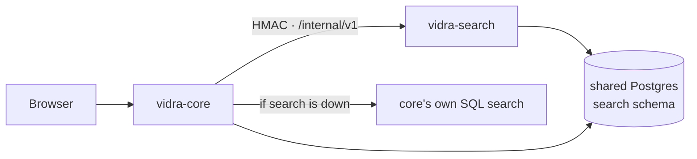

# Search and discovery

Search is a **separate service**,
[`vidra-search`](https://github.com/yegamble/vidra-search), and the most
important thing about it is what happens when it is not there: core falls back
to its own SQL search. Search never takes the site with it.



## What it does

| Capability | How |
|---|---|
| **Hybrid search** | Full-text plus trigram matching, so a query finds both the phrase and the near-miss spelling |
| **Autosuggest** | Typo-tolerant completions as you type |
| **Trending** | Decayed counters, so yesterday's spike stops outranking today's |
| **Recommendations** | Co-visitation — what else people who watched this watched |
| **Learned ranking** | A LightGBM ranker, **shadow-evaluated online** before anyone activates it manually |

The ranker is the part worth reading twice: it is trained and then run in
shadow against live traffic, scoring queries without affecting what anyone sees,
until an operator decides the numbers justify switching it on. It is never
enabled by a training run.

## It is internal, and it stays internal

`vidra-search` is called **only** by `vidra-core`, over the compose network,
HMAC-authenticated with a shared `SEARCH_INTERNAL_SECRET`. Its contract lives at
`vidra-search/api/openapi.yaml`, entirely under `/internal/v1`.

Do not add a Caddyfile site for it and do not publish its port past the host —
the production overlay removes the publish entirely. Its host port
(`SEARCH_HTTP_PORT`, default 8081) exists for local inspection in development.

## Wiring it in production

The explicit `-f` chain a production deploy uses **disables** the automatic merge
of `docker-compose.override.yml` — which is intended, but that override file is
also the only place the api's search wiring is set in development. In production
you must set both values in the env file:

```bash
SEARCH_SERVICE_URL=http://search:8080
SEARCH_INTERNAL_SECRET=<openssl rand -hex 32>   # must equal the search service's INTERNAL_SECRET
```

The two failure modes are asymmetric, and only one of them is loud:

- **Leave `SEARCH_SERVICE_URL` empty** and the whole search integration is
  disabled. The site degrades gracefully to local SQL search with **no error
  anywhere** — exactly the kind of silence that survives to production.
- **Set the URL without the secret** and `validate()` requires at least 32
  characters and the api refuses to boot.

`vidra doctor` has a **search service** check for the first case.

## Rotating the shared secret

`SEARCH_INTERNAL_SECRET` must change on **both services in one deploy**. It is a
shared HMAC: one `${SEARCH_INTERNAL_SECRET}` substitution feeds the api's
variable and the search service's `INTERNAL_SECRET`, so a single env-file edit
plus one `up -d` is atomic enough. A split rollout means every core-to-search
call 401s until it converges.

## One database, one dump

`vidra-search` shares the core database in the `search` schema, so the nightly
database-wide dump already includes it. It has its **own migration ledger**
(`public.vidra_search_migrations`) and its own migrator one-shot; either ledger
can go dirty without the other, which is why `deploy.sh` runs the two migrators
as separate gated steps.
