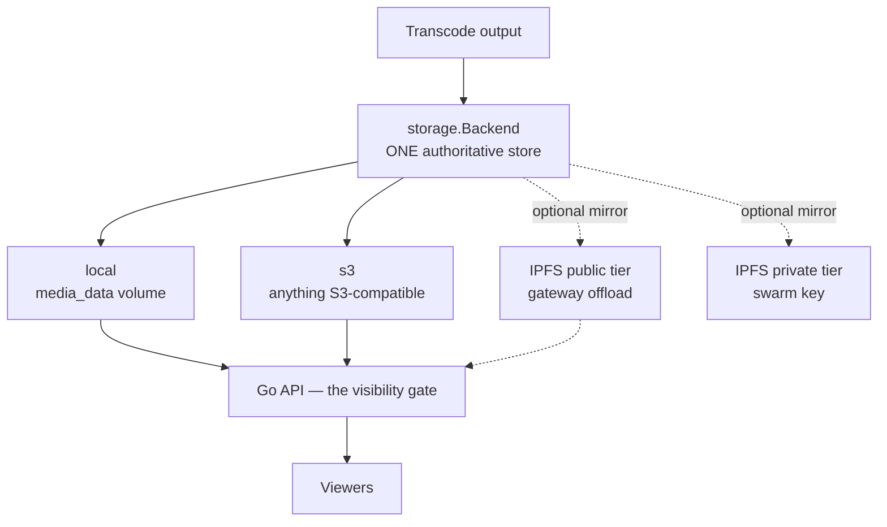

# Storage and media

There is exactly **one authoritative store** at a time — local disk or an
S3-compatible bucket — and everything else is a mirror. Getting that hierarchy
right is the whole model.



## The backend interface

One global `storage.Backend` with an optional-capability pattern
(`PathProvider`, `ObjectLister`, `PrefixDeleter`). Objects are addressed by
**relative, backend-opaque keys** — the database stores a `storage_key` and
knows nothing about how the backend resolves it, which is what makes moving
between backends possible at all.

| Backend | `STORAGE_BACKEND` | Notes |
|---|---|---|
| Local filesystem | `local` | **Requires the `media_data` volume** from the prod overlay. Without it the default root resolves to the container's writable layer, and `up -d` destroys the media while the Postgres rows survive pointing at nothing. |
| S3-compatible | `s3` | The production default. DigitalOcean Spaces, Backblaze B2, AWS S3, MinIO. Set `STORAGE_S3_ENDPOINT` to a **host only, with no scheme** — a `://` is rejected at config load. Also set `STORAGE_S3_REGION`, and pre-create the bucket. |

MinIO ships in the compose stack behind the `storage` profile for local
development against the S3 path.

## Backups do not include media

`deploy/backup.sh` writes a `pg_dump` and a config archive. **Neither contains a
byte of media**, and that is deliberate.

- With `STORAGE_BACKEND=s3`, media durability is a **bucket setting**: versioning,
  or cross-region replication, or both. Nothing a shell script here could do
  would beat what the provider already offers.
- With `STORAGE_BACKEND=local`, the media lives in the `vidra_media_data` Docker
  volume that nothing backs up, while the rows pointing at it are dumped nightly.
  Restore that dump onto a new host and you get a complete catalogue of videos
  that will not play. Snapshot the volume yourself; the procedure is in
  [Storage backends](../install/storage-backends.md).

:::warning Versioning without a lifecycle rule is a billing trap
On a versioned bucket a delete writes a delete marker and the previous version
keeps existing and keeps billing, forever. Vidra's media GC can report deleting
thousands of objects while freeing exactly zero bytes — both numbers are true,
only one is on the invoice. Pair versioning with a rule that expires non-current
versions; thirty days is a sane default. `vidra doctor` reports this under
**object retention**. It matters most on Backblaze B2, whose buckets are
versioned by default.
:::

## IPFS: a mirror, in two tiers

IPFS is the shipped **distribution-offload** mechanism. It is a mirror sidecar,
never the authority: local or S3 storage stays the source of truth, and the
mirror's health never reflects on whether media serves.

| Tier | Profile | What it is |
|---|---|---|
| **Public** | `ipfs` | A Kubo node that pins eligible public media and hands playback a gateway URL. `IPFS_PUBLIC_GATEWAY_URL` defaults to `https://ipfs.io`; point it at your own gateway if you have one. |
| **Private** | `ipfs-private`, `ipfs-private-cluster` | A separate swarm-keyed node — a closed network for content that must not leave it. |

`make ipfs-live` runs the public mirror on a live node alongside the private one.
Kubo's RPC ports are loopback-only; only the libp2p swarm port (4001, TCP and
UDP) is public, and it has to be, because peers dial in and a node nobody can
reach only ever pushes.

Eligibility is **default-deny**, and the routing is fail-closed: the mirror
decides what may be published, and a network it cannot reach means nothing is
published rather than something leaking.

:::danger A public CID can outlive your node
This is an intentional disclosure boundary, not a bug: **a public CID may remain
retrievable after the local node unpins it.** Anything that has been announced to
the public IPFS network is potentially permanent. Do not put anything on the
public tier that you might later need to make unavailable — that is what the
private swarm-keyed tier is for.
:::

Mirror status is at `GET /api/v1/ipfs/status` (admin): whether it is enabled,
node reachability, the gateway in use, whether a cluster is configured, and pin
counts overall and per media class. It answers `503 ipfs_disabled` when both
tiers are off.

Operators can also opt into a dedicated reference node for individually
approved videos. It serves IPFS blocks from immutable S3 object versions
through a private origin. Cold reads depend on both services, while peers
that already hold the blocks can continue serving them independently.
[Versioned S3 reference pins](../install/storage-backends.md#versioned-s3-reference-pins)

On an instance with the reference playback bridge enabled, an approved public
video offers **Use IPFS** on its watch page. Select it to play the approved
rendition. If that source stalls or becomes unavailable, the player falls back
to the instance’s ordinary HLS stream. A new transcode generation needs its own
approval. Withdrawing a video removes the instance’s playback option. Peers that
already downloaded a public CID may keep their copies.

If you need the CID for a particular video, send its watch URL to the site
operator and ask whether it has an approved public reference pin. The admin
health screen reports an aggregate count. The operator can check the individual
approval and test that CID from an independent peer. [Checking reference pins](../operate/monitoring.md#check-s3-reference-pins)

## Delivery is gated by the API, not by the store

Vidra's normal playback and download routes proxy media through the Go API
with a per-request database-backed authorisation check. That is what makes
private videos private, and it is why you cannot simply point a public CDN at
the bucket and call it done. The layered
gates (`videoVisibleForMedia`, `videoForDownload`) are ordered so a failed check
leaks nothing about whether the video exists.

The consequences for caching are in
[The video pipeline](./video-pipeline.md#deliver): per-asset-shape cache policy,
`?v=` generation keys for immutable HLS, `?pt=` tokens for password-protected
playback, and Range support that any CDN in front must preserve.

## Verifying the two halves still match

A dump is a snapshot of the database at time T; the bucket is whatever it is at
T+n. After a restore they are no longer a matched pair, in both directions.

```bash
# fast pass: does the store have every object the database references?
docker compose … run --rm api verify-blobs --timeout=10m

# full pass: re-download and compare digests. Reads the whole library.
docker compose … run --rm api verify-blobs --hash --deep --timeout=4h
```

`restore.sh` runs the fast pass automatically and **never blocks on it** —
aborting a restore over a media problem that not booting does not fix would be
the wrong trade. `--hash` is the only mode that detects media that is present
but corrupt; `--deep` walks each HLS tree instead of trusting that a present
master manifest implies a present ladder.

`verify-blobs` never writes — there is no repair mode, because every plausible
repair destroys information and only you know which store is the stale one — and
it must not be run during a storage migration, when the two stores are
deliberately out of step.

The media GC has matching safety rails, and they exist for exactly the
restore case: an ownership marker refuses to delete from a store this install
has not been shown to own, an orphan-ratio breaker refuses a sweep that finds an
implausible share of the store to be garbage (a freshly restored older database
looks exactly like that), and the first sweep after any restart is always a dry
run.
