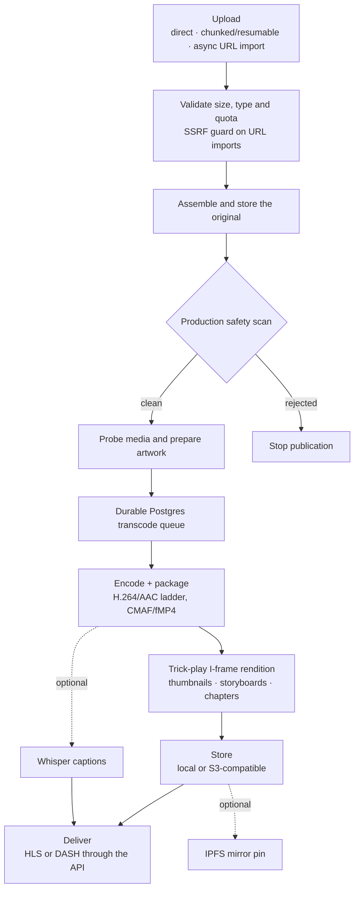
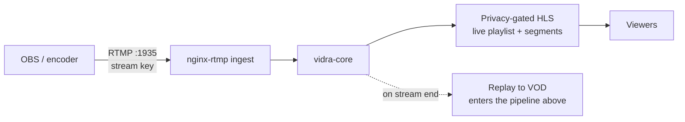

# The video pipeline

Everything between "a file arrives" and "a viewer presses play" is one queue-driven
pipeline. It is asynchronous by design: the upload finishes long before the
encode does, and the video becomes playable when the encode lands.

## Video on demand

### Ingest

Three ways in: a direct upload, a chunked resumable upload, and an async URL
import (SSRF-guarded, with an optional sandboxed yt-dlp extractor behind the
`ytdlp` profile). Per-user storage quotas apply to all three. Channel auto-sync
can mirror an external channel's uploads on a schedule.

Channel auto-sync is off by default (`CHANNEL_SYNC_ENABLED`) and works only while
yt-dlp import is also enabled; synced uploads arrive as private drafts. Three of
its timing knobs are runtime settings, edited in the admin console under
**VOD → Imports** with no restart. Each defaults to its env value, and a write
outside the range is rejected:

| Setting | Env default | Range | What it does |
|---|---|---|---|
| `channel_sync_batch` | `CHANNEL_SYNC_BATCH` (15) | 1 to 100 | Newest uploads imported per pass |
| `channel_sync_cooldown_minutes` | `CHANNEL_SYNC_COOLDOWN` (1m) | 1 to 1440 minutes | Minimum gap between manual sync-now requests; an early request gets a 429 |
| `channel_sync_backoff_max_hours` | `CHANNEL_SYNC_BACKOFF_MAX` (24h) | 1 to 720 hours | Cap on the doubling wait before a failing sync retries |

The cooldown setting cannot turn the throttle off. That is
`CHANNEL_SYNC_COOLDOWN=0`, read at boot only. The re-list cadence
(`channel_sync_interval_minutes`, 5 to 10080 minutes) is editable in the same
section.

### When an upload reaches 100%

Studio transfers the file in resumable chunks. At 100%, the server still has to assemble the original, scan it and inspect its media streams. Encoding the playback renditions is a separate job. You can check the video in Studio while processing continues. After an interrupted transfer, select the same file to resume the open session. Sessions expire after 24 hours.

If processing ends in **Failed**, give the operator the video ID, the approximate time and the error shown in Studio. Keep private files and sign-in details out of the report.

Operators can open the job details in the admin panel and use the correlation ID to find the matching worker log. If a scanner error left an original in storage, the operator can check whether it still qualifies for a rescan. [Retry an upload after a scanner error](../operate/monitoring.md#retry-an-upload-after-a-scanner-error)

| Failed job | What to check |
|---|---|
| `upload_finalize` | Check original assembly, the scanner verdict and the probe. A scanner connection, size-limit or timeout error leaves the original without a clean verdict. Restore scanning and run normal ingestion before making the video available. |
| `video_transcode` | Check the encoder diagnostic and which renditions reached ready. After correcting the encoder, staff can regenerate HLS for an existing, successfully ingested original. Verify that a viewer can play the new rendition. |

The production template uses `CLAMAV_ADDR` and the `scan` Compose profile. `MALWARE_SCAN_MODE=fail-closed` stops publication when the scan cannot complete. Budget memory for the signature database and scratch space for the largest concurrent uploads. Align the API's effective `upload_max_size_bytes`, creator quotas, clamd's `StreamMaxLength` and `MaxFileSize`, and the end-to-end `CLAMAV_TIMEOUT`. Test a clean file at the advertised boundary and check that the scanner detects a harmless test signature there before increasing the limit. [ClamAV scanner configuration](https://docs.clamav.net/manual/Usage/Configuration.html)

### Encode and package

Encoding and packaging are one ffmpeg invocation, not two passes: the muxer is an
output of the same run that drives the encoder.

- **Ladder:** fixed-bitrate H.264 with AAC audio. Ladder planning is
  input-aware — it never upscales, keeps a native fallback rung, and caps frame
  rate.
- **Packaging:** `TRANSCODING_PACKAGER=cmaf` is the default and writes one set
  of CMAF/fMP4 segments addressed by **both** an MPEG-DASH manifest and HLS
  playlists. `ts` is the legacy MPEG-TS-plus-HLS packager, kept as a
  config-only rollback: it affects new transcodes only, every video records the
  format its own tree was written in, and there is deliberately no
  back-catalogue re-packaging job.
- **Trick-play:** an I-frame rendition per rung, which is what makes scrub
  previews work.
- **Also produced:** progressive web videos, an optional VP9/WebM download
  alternate, thumbnails, storyboards and chapters.
- **HEVC and AV1** are behind `TRANSCODING_HEVC_ENABLED` and
  `TRANSCODING_AV1_ENABLED`, both **default off**, both CMAF-only. Each adds a
  further encoding of every ladder rung.
- **Hardware transcode** is behind `TRANSCODING_HW` — `off` by default, with
  `videotoolbox`, `vaapi`, `qsv` and `nvenc` available. It requires the CMAF
  packager; the MPEG-TS path stays software H.264. AV1 is never hardware-encoded
  whatever the setting says.

:::info What a job actually costs
One `TargetAll` job on a 1080p source is **twelve full-source encode passes** —
four ladder rungs, four trick-play I-frame encodes and four progressive web
videos — and runs at roughly **1.5–2.5× the source duration** on 4 vCPU at
`-preset veryfast`. This is why the host is sized for transcoding; see
[Requirements and sizing](../start/requirements.md).
:::

Captions are optional and asynchronous: with the `captions` profile on, the
audio is handed to the Whisper service and the resulting WebVTT is stored
alongside the video. Uploaded WebVTT works with or without it.

### Deliver

Every media byte is proxied through the Go API, with a per-request database-backed
authorisation check — the API is the visibility gate for originals, HLS and
thumbnails. Playlists are rewritten in flight: a `?pt=` HMAC token propagates to
child requests for password-protected videos, and a `?v=` generation key makes a
completed transcode's URLs immutably cacheable.

Cache policy is emitted per asset shape, which is why a blanket public rule on
`/api/v1/videos/*` is wrong — a video can become private or be deleted, and
playback tokens appear in the query string:

| Asset | Policy |
|---|---|
| Versioned VOD HLS (`?v=<generation>`) | `private, max-age=31536000, immutable` |
| Unversioned VOD HLS compatibility URL | `private, max-age=0, must-revalidate` |
| Authenticated or `?pt=` media | `private, no-store` |
| Live playlist | `no-cache, no-store` |
| Live segment | `private, max-age=12` |
| Replaceable thumbnail | `private, max-age=300, must-revalidate` |

The original-file route supports `Accept-Ranges` and `206 Partial Content` on
both local and S3 storage, so any CDN or proxy in front must preserve Range
requests — that is what seeking is.

## Live

Live runs behind the `media` compose profile. RTMP ingest publishes
`0.0.0.0:1935` **around the edge** — OBS on a creator's laptop dials it directly
and a reverse proxy cannot stand in front of it, so 1935 is one of the two ports
that must be open in your firewall when the profile is on.

The live HLS output goes through the same privacy gate as VOD, and a finished
stream can be replayed to VOD, at which point it becomes an ordinary transcode
job.

`LIVE_INGEST_SECRET` signs stream keys. Rotating it is free: it breaks any
in-flight session, and new stream keys work immediately.

## What is not in the pipeline

- **No in-player peer-to-peer.** Viewer-to-viewer distribution is deferred by
  decision. Offload happens at the CDN and IPFS layers instead; see
  [Storage and media](./storage-and-media.md).
- **No EME or DRM in the player.**
