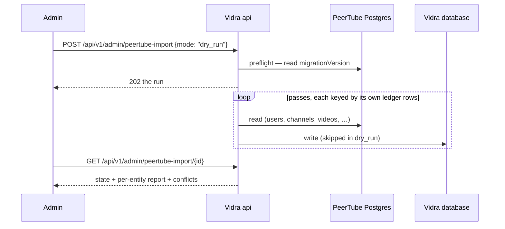

# Admin API import

The managed path. You launch a run, the api executes it, and you poll it for
progress. The source connection is **not in the request** — it comes from server
config only, so the browser never sends a DSN or a credential.

In the UI it lives at `<your domain>/admin/import-peertube`. The endpoints below
are what that page drives.



## Prerequisites

Configured in `env/production.env` — see
[Planning, step 5](./planning.md#step-5-configure-the-source-in-the-env-file).
Without `PEERTUBE_IMPORT_ENABLED=true` and a source DSN, every call below
answers **503**.

All three endpoints require an **admin** bearer token, and every run is audited
(with no secrets in the audit record).

## Launch a run

```
POST /api/v1/admin/peertube-import
```

| Field | Required | Default | What |
|---|---|---|---|
| `mode` | yes | — | `dry_run` reports the plan and writes **nothing**; `run` performs the import. |
| `conflict_policy` | no | `skip` | `skip` \| `rename` \| `merge` \| `fail`. How username, handle, email and slug collisions with existing Vidra rows are resolved at insert time. |
| `source_authoritative` | no | `false` | Whether a re-run may **update** rows the import already owns. See [the overview](./overview.md#it-is-idempotent-resumable-and-re-runnable). |
| `acknowledged_schema_version` | no | none | The unverified source schema version an administrator explicitly accepts for this run. The server never sets it for itself. |

Always dry-run first:

```bash
RUN=$(curl -sf -X POST https://example.com/api/v1/admin/peertube-import \
  -H "Authorization: Bearer $ADMIN_TOKEN" \
  -H 'Content-Type: application/json' \
  -d '{"mode":"dry_run"}' | jq -r '.id')
echo "$RUN"
```

Responses: **202** with the run, **400** on an invalid mode, conflict policy or
a negative acknowledged version, **401**/**403** on auth, **409** if a run is
already in progress — only one may be active at a time — and **503** when import
is not configured on this instance.

## Poll it

```bash
curl -sf "https://example.com/api/v1/admin/peertube-import/$RUN" \
  -H "Authorization: Bearer $ADMIN_TOKEN" | jq '{state, source_version, report, error_code}'
```

The run object carries:

| Field | What |
|---|---|
| `id`, `mode`, `conflict_policy` | What was launched |
| `state` | `pending` \| `running` \| `done` \| `failed` |
| `source_version` | The `application.migrationVersion` preflight detected — **populated even when preflight refused it**, because it is the number an administrator has to be shown before being asked to acknowledge it |
| `acknowledged_schema_version` | What was signed off on, or null (the norm) |
| `report` | Per-entity progress and conflicts |
| `error` | A safe, client-visible failure reason — never a DSN or credential |
| `error_code` | A stable snake_case failure class; branch on this, read `error` as prose |
| `created_at`, `updated_at`, `started_at`, `finished_at` | Timing |

List recent runs — the import history plus the active run's live progress,
newest first:

```bash
curl -sf https://example.com/api/v1/admin/peertube-import \
  -H "Authorization: Bearer $ADMIN_TOKEN" | jq '.'
```

## Reading a dry run

The dry run reports the plan, the conflicts and the counts, and writes nothing.
For the image families it sends **not one HTTP request** to the source.

Its `entities` map covers `category_taxonomy`, `view_count`,
`video_original_date`, `video_publication_date`, `chapter`, `rating`, `rendition`, `actor_avatar`,
`actor_banner`, `thumbnail` and `storyboard` alongside users, channels, videos,
comments, playlists and captions.

Read the following counters in their source units.

- **`view_count` counts videos**, never views — it is how many videos would have
  a total carried.
- **`video_original_date` counts videos** carrying an `originallyPublishedAt`,
  and is 0 for a source too old to have that column at all.
- **`video_publication_date` counts videos** carrying a source `publishedAt`.
  This is the timestamp used for newest-first browsing when available.
- **`category_taxonomy` is one setting**, so it is 0 or 1.

Compare the rest against your
[inventory](./planning.md#step-1-inventory-the-source). If the numbers agree,
run it for real.

## Run it

```bash
RUN=$(curl -sf -X POST https://example.com/api/v1/admin/peertube-import \
  -H "Authorization: Bearer $ADMIN_TOKEN" \
  -H 'Content-Type: application/json' \
  -d '{"mode":"run"}' | jq -r '.id')

while :; do
  STATE=$(curl -sf "https://example.com/api/v1/admin/peertube-import/$RUN" \
    -H "Authorization: Bearer $ADMIN_TOKEN" | jq -r '.state')
  echo "$STATE"
  case "$STATE" in done|failed) break;; esac
  sleep 10
done
```

The run is idempotent and resumable: it skips already-imported rows via the
durable ledger, so re-launching after an interruption continues rather than
duplicating.

## When preflight refuses the schema version

```json
{
  "state": "failed",
  "error_code": "unverified_schema",
  "source_version": 1040
}
```

That is the **one** failure an administrator may overrule. Re-launch with the
detected version acknowledged:

```bash
curl -sf -X POST https://example.com/api/v1/admin/peertube-import \
  -H "Authorization: Bearer $ADMIN_TOKEN" \
  -H 'Content-Type: application/json' \
  -d '{"mode":"dry_run","acknowledged_schema_version":1040}'
```

Acknowledging a version grants **no permission to overwrite anything** — it is a
version gate, not a write policy, and is independent of `source_authoritative`.

`error_code: undetectable_schema` is different: no version could be read from
the source at all, so there is nothing to acknowledge. That one needs a human on
the [command-line importer](./manual-migration.md) with `--force`.

## Keeping in sync until cutover

Launch a run on a schedule against the still-live source. Each one is a delta:
new rows are inserted, view totals are applied as a difference, and already
imported rows are skipped.

To have **edits** on the source follow too — a retitled video, a changed
password, a moved chapter — add `"source_authoritative": true`. It updates
video, channel and user metadata (including the password hash), chapters, video
tags, ratings, playlist items, subscriptions, the category taxonomy and actor
images. It never touches a row created on Vidra, never re-inserts, never rotates
an actor keypair, never assigns a view count, never overwrites a rendition row
and never re-downloads media.

## Next

- **[Media migration](./storage-migration.md)** — the media modes and what each
  one leaves you with.
- **[Cutover and validation](./cutover.md)**.
- **[Command-line importer](./manual-migration.md)** — when the API cannot do
  what you need.
